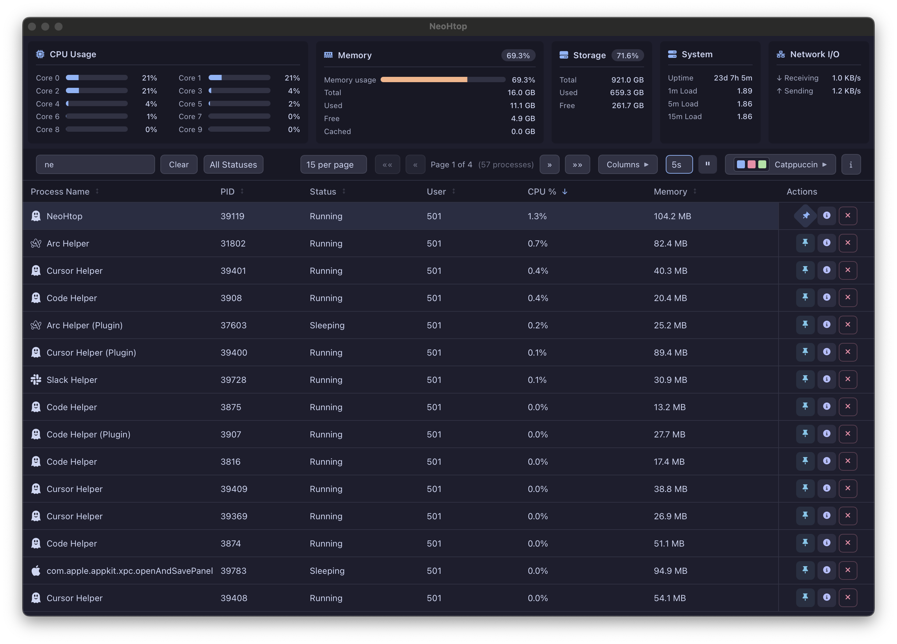

<div align="center">
  
  <h1>NeoHtop</h1>
  <p>A modern, cross-platform system monitor built on top of Svelte, Rust, and Tauri.</p>

  [](https://github.com/Abdenasser/neohtop/blob/main/LICENSE)
  [](https://github.com/Abdenasser/neohtop/stargazers)
  [](https://github.com/Abdenasser/neohtop/issues)
  [](https://github.com/Abdenasser/neohtop/releases)
  [](https://developer.apple.com/documentation/security/notarizing-macos-software-before-distribution)
</div>

<div align="center">
  <picture>
    <!-- <source media="(prefers-color-scheme: dark)" srcset="screenshot.png">
    <source media="(prefers-color-scheme: light)" srcset="screenshot-light.png"> -->
    
  </picture>
</div>

<div align="center">
  <p>If you find this project helpful, consider buying me a coffee:</p>
  <a href="https://www.buymeacoffee.com/abdenasser" target="_blank"></a>
  <p>Or sponsor me on GitHub:</p>
  <a href="https://github.com/sponsors/Abdenasser" target="_blank"></a>

</div>

<br>

<div align="center">
  <table>
    <tr>
      <td align="center">
        <h2>👻 NEW: <a href="https://github.com/Abdenasser/neohtop-cli">NeoHtop CLI</a> is here!</h2>
        <p><strong>All the power of NeoHtop, right in your terminal</strong> — real-time CPU sparklines, memory bars, process tree view, search, filters, themes & more.</p>
        <p>Built with <b>Go</b> + the <b>Charm</b> ecosystem. Works everywhere — macOS, Linux, Windows.</p>
        <br>
        <a href="https://github.com/Abdenasser/neohtop-cli"></a>&nbsp;
        <a href="https://www.npmjs.com/package/neohtop-cli"></a>
        <br><br>
        <pre>npm install -g neohtop-cli</pre>
      </td>
    </tr>
  </table>
</div>

## Table of Contents
- [Why NeoHtop?](#why-neohtop)
- [Features](#features)
- [Tech Stack](#tech-stack)
- [Getting Started](#getting-started)
  - [Prerequisites](#prerequisites)
  - [Installation](#installation)
  - [Running with Sudo](#running-with-sudo)
- [Development](#development)
  - [Setup](#setup)
  - [Code Formatting](#code-formatting)
  - [Pull Requests](#pull-requests)
- [Contributing](#contributing)
- [License](#license)

## Why NeoHtop?
[Read about the back story and motivation behind NeoHtop](https://www.abdenasser.com/2024/11/06/oh-boy-neohtop/)

## Features
- 🚀 Real-time process monitoring
- 💻 CPU and Memory usage tracking
- 🎨 Beautiful, modern UI with dark/light themes
- 🔍 Advanced process search and filtering
- 📌 Pin important processes
- 🛠 Process management (kill processes)
- 🎯 Sort by any column
- 🔄 Auto-refresh system stats

### Search Functionality
Search for processes by name, command, or PID. Use commas to search for multiple terms simultaneously. Regular expressions are supported for advanced filtering.

Examples:
- `arm, x86`: Returns processes with "arm" or "x86" in the name or command
- `d$`: Lists daemons (processes ending with 'd')
- `^(\w+\.)+\w+$`: Shows processes with reverse domain name notation (e.g., com.docker.vmnetd)

## Tech Stack
- **Frontend**: SvelteKit, TypeScript
- **Backend**: Rust, Tauri
- **Styling**: CSS Variables for theming
- **Icons**: FontAwesome

## Getting Started

### Prerequisites
- Node.js 22 (see `.nvmrc`)
- Rust (latest stable)
- Xcode Command Line Tools (for macOS)

### Installation

#### Manual
Download the latest release from the [releases page](https://github.com/Abdenasser/neohtop/releases).

#### Package Managers

Members of the community have kindly published unofficial packages for various platforms and package managers.

Please note, these packages are community-maintained and not officially released, reviewed, or endorsed by NeoHtop.
We only provide official builds through the GitHub Releases page.
Since these external packages are managed by third parties, we cannot guarantee their security, integrity, or update frequency.

Please use them at your own discretion.

##### macOS

Using [Homebrew](https://brew.sh/).

```bash
brew install --cask neohtop
```

##### Arch Linux (AUR)

Using the [AUR](https://aur.archlinux.org/) and [an AUR helper](https://wiki.archlinux.org/title/AUR_helpers).

```bash
yay -S neohtop
```

or

```bash
paru -S neohtop
```

##### Fedora Linux
Install the [Terra repository](https://terra.fyralabs.com/).

```bash
dnf install neohtop
```

##### Windows
Install the [Scoop repository](https://scoop.sh/), then make sure you have the Scoop extras bucket added:

```bash
scoop bucket add extras
```

Then install with:

```bash
scoop install extras/neohtop
```

##### Solus

```bash
eopkg install neohtop
```

### Running with Sudo
Some processes require monitoring with sudo privileges. To monitor these processes, launch NeoHtop with sudo:

- macOS: `sudo /Applications/NeoHtop.app/Contents/MacOS/NeoHtop`
- Linux: `pkexec /path/to/neohtop` (recommended)

## Development

### Setup
```bash
# Install dependencies
npm ci

# Run in development mode
npm run tauri dev

# Build for production
npm run tauri build
```

### Build checks and releases

Pull requests and pushes to `main` run formatting, type checks, release-tool tests,
and package builds for Windows x64, macOS Intel/Apple Silicon, and Linux x64/ARM64.
Linux packages are built on Ubuntu 22.04; newer distributions still need the
appropriate WebKitGTK runtime. AppImages are checked for bundled Wayland client
libraries to prevent the display-driver conflict reported in issue #203.

To build preview packages, run **Build Check** or **Draft Release** from GitHub
Actions on a branch. Download the `packages-*` workflow artifacts. Preview macOS
packages are ad-hoc signed and are not notarized for public distribution.

For a release candidate:

1. Update the version in `package.json`, both root version entries in `package-lock.json`,
   `src-tauri/tauri.conf.json`, `src-tauri/Cargo.toml`, and the NeoHtop entry in
   `src-tauri/Cargo.lock`. Run `npm run release:check` and commit the changes.
2. Push a matching version tag, for example `v1.3.0`. All platform packages are
   built from that tag. A published version cannot be overwritten.
3. After every build passes, **Draft Release** verifies all nine packages and
   attaches `SHA256SUMS` and `release-manifest.json` to a draft GitHub release.
4. Install and launch the packages on their supported operating systems, review
   the release notes, then publish the draft from GitHub when ready.

Tagged macOS builds require the existing repository secrets `MACOS_CERTIFICATE`
(base64-encoded Developer ID `.p12`), `MACOS_CERTIFICATE_PASSWORD`, `APPLE_ID`,
`APPLE_PASSWORD` (an app-specific password), and `APPLE_TEAM_ID`. The optional
repository variable `APPLE_SIGNING_IDENTITY` overrides the current Developer ID
identity. Tagged builds fail if credentials are missing or signature/notarization
checks fail. Preview builds and pull requests do not need signing credentials.
Windows packages are NSIS installers, named `NeoHtop_<version>_x64-setup.exe`;
Windows code signing is not configured by this workflow.

The release uses the scoped `GITHUB_TOKEN`; `PAT_TOKEN` is no longer needed.
Existing branch-protection rules that require the old **Format Check** job should
be updated to require **Source checks** and the platform package jobs.

### Code Formatting
We use Prettier for web code and `cargo fmt` for Rust code.

```bash
# Format all files
npm run format

# Check formatting without making changes
npm run format:check
```

### Pull Requests
Before submitting a PR, ensure:
1. All code is formatted (`npm run format`)
2. The format check passes (`npm run format:check`)
3. Your commits follow the project's commit message conventions

## Contributing
We welcome contributions! Please see our [contributing guidelines](./.github/CONTRIBUTING.md) for more information.

## License
This project is licensed under the MIT License - see the [LICENSE](LICENSE) file for details.
