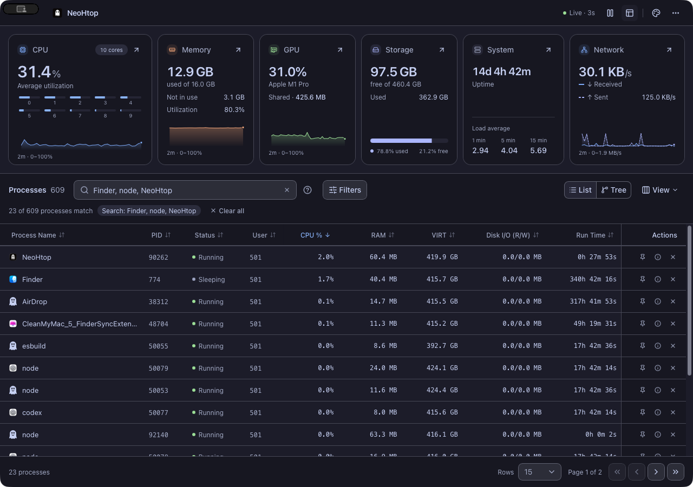

<div align="center">
  
  <h1>NeoHtop</h1>
  <p><strong>Your system. In plain sight.</strong></p>
  <p>A modern, open-source system monitor for macOS, Linux and Windows.<br />Explore processes, understand your graphics card, and keep your whole machine in view.</p>

<a href="https://github.com/Abdenasser/neohtop/releases/latest"></a>
<a href="https://github.com/Abdenasser/neohtop/actions/workflows/build-check.yml"></a>
<a href="LICENSE"></a>
<a href="https://github.com/Abdenasser/neohtop/stargazers"></a>

  <p><a href="https://github.com/Abdenasser/neohtop/releases/latest"><strong>Download NeoHtop</strong></a> · <a href="https://abdenasser.github.io/neohtop/">Website</a> · <a href="CHANGELOG.md">What’s new</a> · <a href="docs/screenshots/README.md">Screenshots</a> · <a href="docs/usage.md">Desktop guide</a></p>
</div>

<picture>
  <source media="(prefers-color-scheme: light)" srcset="docs/screenshots/desktop-light.jpg" />
  
</picture>

<p align="center"><sub>Real desktop UI. Dark, light, and 22 more ways to make it yours. Free, local, and open source.</sub></p>

## Meet NeoHtop 1.3

A fresh desktop experience with more to explore—from the process holding a port to the GPU doing the work.

- **Go beyond a flat process list.** Expand process families, see their combined CPU and RAM, and keep matching children in context while you search.
- **See your graphics card.** GPU utilization, memory and driver-reported diagnostics sit alongside CPU, RAM, storage, system and network readings.
- **Keep the essentials in your menu bar.** A compact companion shows live resources and your busiest processes. Jump straight into an inspector without hunting through the table.
- **Put a name to the process.** Native app icons when the system can provide them; the familiar ghost when it can’t.
- **Find what owns a port.** Type `:3000` or `port:443`. Socket scans run only when you need them.
- **Keep the themes you love.** All **24 themes**, rebuilt around consistent shadcn-svelte controls, readable tokens, and a searchable gallery.

[Read the complete v1.3.0 changelog →](CHANGELOG.md)

<table>
  <tr>
    <td width="50%"><br /><strong>Go deeper from every resource card.</strong><br /><sub>CPU cores, memory breakdowns, graphics adapters, mounted volumes, system identity and network interfaces.</sub></td>
    <td width="50%"><br /><strong>Your setup, your atmosphere.</strong><br /><sub>Dark, light, colorful, retro and accessible palettes. The same theme follows you across app windows.</sub></td>
  </tr>
</table>

## Less hunting. More understanding.

| What you’re looking for           | Where to start                                                                |
| --------------------------------- | ----------------------------------------------------------------------------- |
| A process eating CPU or RAM       | Sort the table, filter by usage, pin it, or open its inspector.               |
| What belongs to an app            | Switch to **Tree** and expand its process family.                             |
| The server holding your dev port  | Search **`:3000`** or **`port:443`**. A bare number still finds a PID.        |
| GPU load and memory               | Open **Graphics** from the GPU card; select an adapter on multi-GPU machines. |
| A sudden resource spike           | Inspect the CPU, memory, GPU or network chart with the pointer or keyboard.   |
| Traffic on a particular interface | Open **Network**, search interfaces, or include inactive ones.                |
| A quick check between tasks       | Open the ghost in the **menu bar/system tray**.                               |
| Your preferred monitoring pace    | Open **Settings → General** and choose a refresh interval.                    |

The charts keep roughly two minutes of history in memory. Pause, inspect and resume from the app bar or companion; both windows share the same sample and monitoring state.

## Download

Official packages are published on [GitHub Releases](https://github.com/Abdenasser/neohtop/releases/latest), with SHA-256 checksums and a build manifest.

| Platform                  | Packages                                                                                                                                                                                                                                                                                                      |
| ------------------------- | ------------------------------------------------------------------------------------------------------------------------------------------------------------------------------------------------------------------------------------------------------------------------------------------------------------- |
| **macOS · Apple Silicon** | [DMG](https://github.com/Abdenasser/neohtop/releases/download/v1.3.0/silicon-NeoHtop_1.3.0_aarch64.dmg)                                                                                                                                                                                                       |
| **macOS · Intel**         | [DMG](https://github.com/Abdenasser/neohtop/releases/download/v1.3.0/intel-NeoHtop_1.3.0_x64.dmg)                                                                                                                                                                                                             |
| **Windows · x64**         | [Installer](https://github.com/Abdenasser/neohtop/releases/download/v1.3.0/NeoHtop_1.3.0_x64-setup.exe)                                                                                                                                                                                                       |
| **Linux · x86_64**        | [deb](https://github.com/Abdenasser/neohtop/releases/download/v1.3.0/NeoHtop_1.3.0_x86_64.deb) · [rpm](https://github.com/Abdenasser/neohtop/releases/download/v1.3.0/NeoHtop_1.3.0_x86_64.rpm) · [AppImage](https://github.com/Abdenasser/neohtop/releases/download/v1.3.0/NeoHtop_1.3.0_x86_64.AppImage)    |
| **Linux · ARM64**         | [deb](https://github.com/Abdenasser/neohtop/releases/download/v1.3.0/NeoHtop_1.3.0_aarch64.deb) · [rpm](https://github.com/Abdenasser/neohtop/releases/download/v1.3.0/NeoHtop_1.3.0_aarch64.rpm) · [AppImage](https://github.com/Abdenasser/neohtop/releases/download/v1.3.0/NeoHtop_1.3.0_aarch64.AppImage) |

[Installation and troubleshooting →](docs/install.md)

<details>
<summary><strong>Prefer a community package manager?</strong></summary>

Community packages are maintained independently and can update on a different schedule from official releases.

| Platform         | Command                                                                   |
| ---------------- | ------------------------------------------------------------------------- |
| Homebrew         | `brew install --cask neohtop`                                             |
| Arch Linux / AUR | `yay -S neohtop` or `paru -S neohtop`                                     |
| Fedora / Terra   | `dnf install neohtop` after enabling [Terra](https://terra.fyralabs.com/) |
| Windows / Scoop  | `scoop bucket add extras`, then `scoop install extras/neohtop`            |
| Solus            | `eopkg install neohtop`                                                   |

</details>

## A few details worth knowing

<details>
<summary><strong>Search, filters and process families</strong></summary>

Search names, commands and PIDs. Commas match any term; regular expressions work too: `node, python`, `d$`, or `^kernel`. Use **Filters** to combine CPU, GPU engine activity, RAM, runtime and status conditions. Clear active conditions in one action.

Tree mode keeps parent context around matches and pages whole families together. Family CPU can exceed 100% across cores; summed resident RAM can double-count shared pages. List mode keeps individual process readings. **View** controls columns, and the bottom bar controls page size.

</details>

<details>
<summary><strong>GPU support depends on your platform and driver</strong></summary>

| Platform | Driver sources                                                                  |
| -------- | ------------------------------------------------------------------------------- |
| macOS    | IORegistry utilization and available Apple silicon shared-memory/core data.     |
| Linux    | AMD amdgpu sysfs and NVIDIA NVML; DRM inventory for other adapters.             |
| Windows  | NVIDIA NVML; DXGI inventory and reported dedicated capacity for other adapters. |

Temperature, power, clock and other counters appear only where exposed. Unsupported or unreadable values stay unavailable. Shared GPU memory on Apple silicon is already part of system RAM.

Optional **GPU %** process columns and filters use **Linux DRM engine accounting**. They need a baseline and can exceed 100% across engines; they are different from the device’s normalized utilization. Collection runs only when the column or filter is enabled. Socket visibility also depends on OS permissions; the app does not request elevation automatically.

</details>

<details>
<summary><strong>Settings, shortcuts and the menu-bar companion</strong></summary>

- **⌘F / Ctrl+F:** focus process search.
- **⌘, / Ctrl+,:** open Settings. General holds refresh/tray behavior; Appearance holds themes.
- **Escape:** clear search when focused, or dismiss an open detail sheet.
- **Chart arrow keys:** inspect recorded samples.

The companion shows CPU, RAM, GPU, network, free storage and the five busiest processes. Select a process to inspect it in the main app. It stops polling while hidden. On some Linux desktops, use the tray menu’s **Show overview** command or the app-bar button.

Closing the main window quits by default. Enable **Keep running when the window closes** to continue from the tray. Closing Settings/About leaves monitoring running; **Quit NeoHtop** always exits. Preferences save automatically and migrate from existing local settings.

</details>

## Build with us

NeoHtop is built with **Rust + Tauri + Svelte**, with **shadcn-svelte + Tailwind CSS** for shared controls and all 24 original themes. Native process icons use platform providers, with Lucide for interface controls.

```sh
git clone https://github.com/Abdenasser/neohtop.git
cd neohtop
npm ci
npm run tauri dev
```

Use **Node.js 22**, **Rust 1.88+**, and the [Tauri prerequisites](https://v2.tauri.app/start/prerequisites/) for your OS.

[Development and release guide](.github/DEVELOPMENT.md) · [Contributing](.github/CONTRIBUTING.md) · [Report a bug](https://github.com/Abdenasser/neohtop/issues) · [Migration notes](SHADCN_MIGRATION.md)

## Prefer your terminal?

Meet [**NeoHtop CLI**](https://github.com/Abdenasser/neohtop-cli), the separate Go/Charm companion with process trees, CPU sparklines, memory bars, filters and themes.

```sh
npm install -g neohtop-cli
```

[Desktop vs CLI →](docs/desktop-vs-cli.md)

## Free today. Open source at the core.

This release is the free, MIT-licensed desktop app. No account or cloud subscription is required. **NeoHtop Pro is postponed** and is not available to buy or install; no launch date or pricing is announced.

If NeoHtop earns a place in your setup, [star the project](https://github.com/Abdenasser/neohtop/stargazers), [sponsor development](https://github.com/sponsors/Abdenasser), or [buy Abdenasser a coffee](https://www.buymeacoffee.com/abdenasser).

[The story behind NeoHtop](https://www.abdenasser.com/2024/11/06/oh-boy-neohtop/) · [MIT License](LICENSE)
