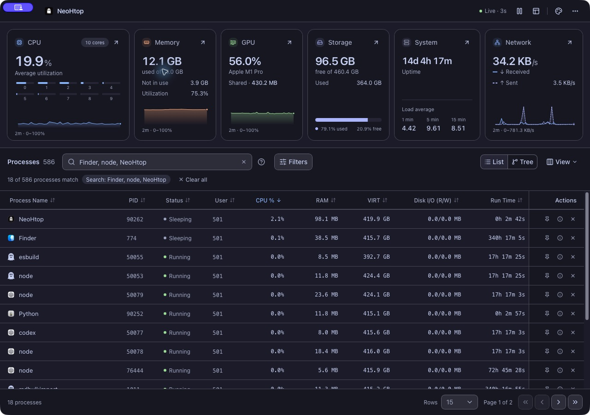
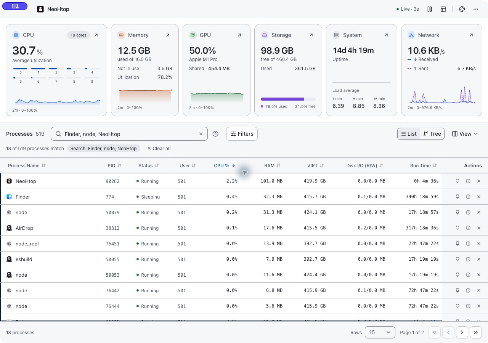
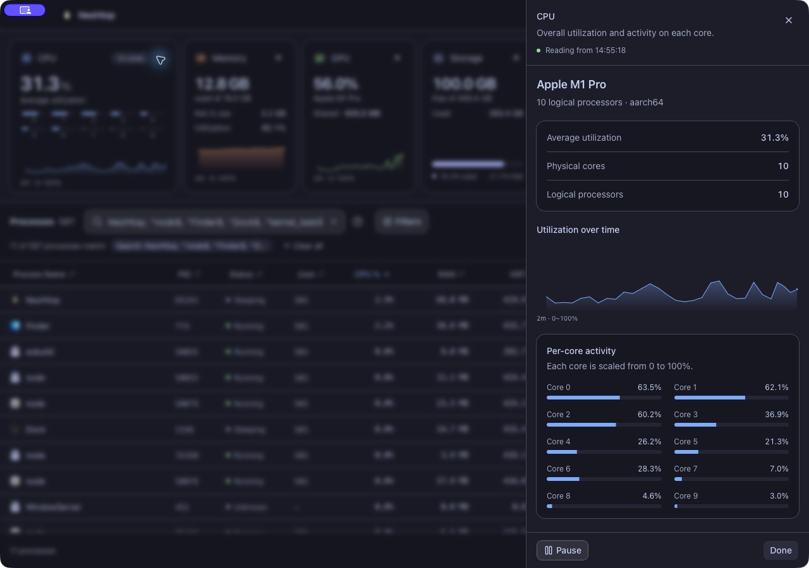
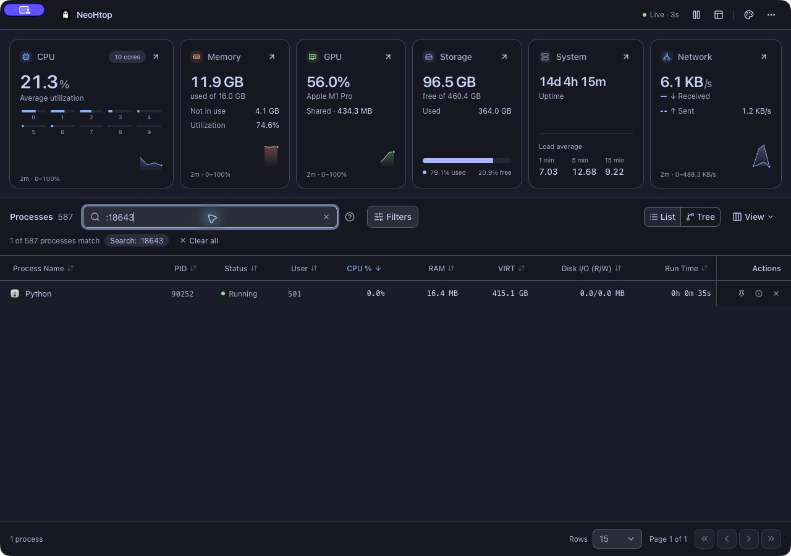
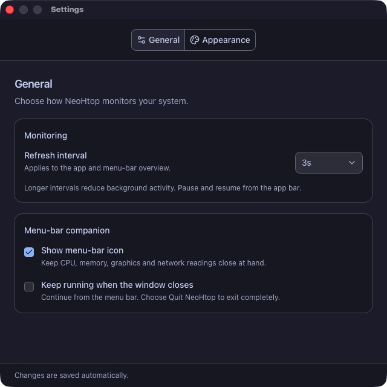
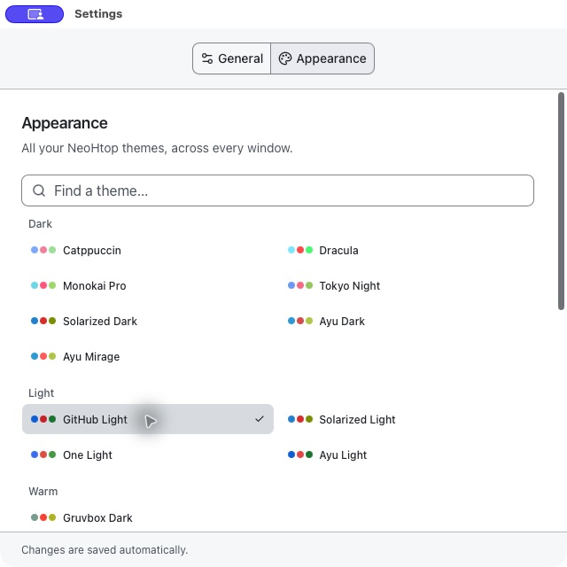

# NeoHtop desktop screenshots

The v1.3.0 desktop interface on macOS. Desktop screenshots are filtered to a few common processes; resource readings are examples from a local machine, not benchmarks. GPU readings and platform chrome vary by operating system and driver.

## Dark appearance

## Light appearance

## Resource details

## Local-port search

## Settings

## All 24 themes

See the [desktop usage guide](../usage.md) for workflows, shortcuts and driver limitations. [Download NeoHtop](https://github.com/Abdenasser/neohtop/releases/latest).
